# Гайд на Русификацию GAC AION V

- [Гайд на Русификацию GAC AION V](#гайд-на-русификацию-gac-aion-v)
	- [Шаг 1. Подготовка флешки](#шаг-1-подготовка-флешки)
	- [Шаг 2. Обновление ГУ на устаревшую версию](#шаг-2-обновление-гу-на-устаревшую-версию)
	- [Шаг 2.5. Подготовительный: Установка ADB на laptop, Раздача hot-stop на laptop](#шаг-25-подготовительный-установка-adb-на-laptop-раздача-hot-stop-на-laptop)
	- [Шаг 3. Запуск ADB на машине, Отключение системных служб](#шаг-3-запуск-adb-на-машине-отключение-системных-служб)
	- [Шаг 4. Установка приложений. Русификация пользовательского интерфейса и голосового ассистента](#шаг-4-установка-приложений-русификация-пользовательского-интерфейса-и-голосового-ассистента)
	- [Шаг 5. Обновление ГУ на актуальную версию](#шаг-5-обновление-гу-на-актуальную-версию)

## Шаг 1. Подготовка флешки

1.1. Откройте «**Проводник**» или «**Мой компьютер**»

1.2. Кликните правой кнопкой мыши по значку вашей флешки и в появившемся контекстном меню выберите пункт «**Форматировать**»

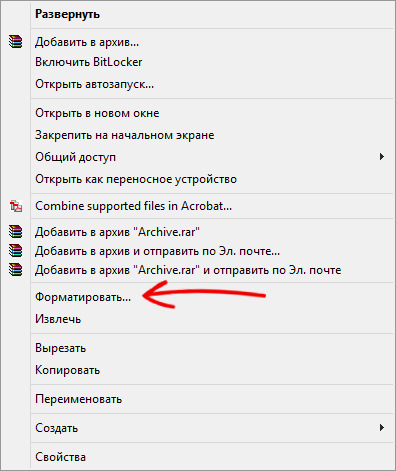

1.3. В открывшемся диалоговом окне «**Форматирование**» в поле «**Файловая система**» выберите пункт «**NTFS**». Значения остальных полей *можно не менять*

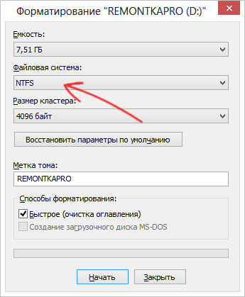

1.4. Нажмите кнопку «**Начать**» и дождитесь завершения процедуры

1.5. Скачиваем файлы с облака и закидываем на флешку

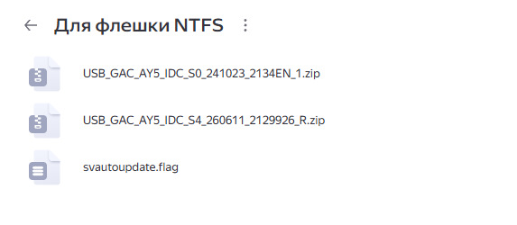

## Шаг 2. Обновление ГУ на устаревшую версию

2.1. **Вставляем флешку** в USB разъем авто(находится возле правой ноги водителя) и **ждем**

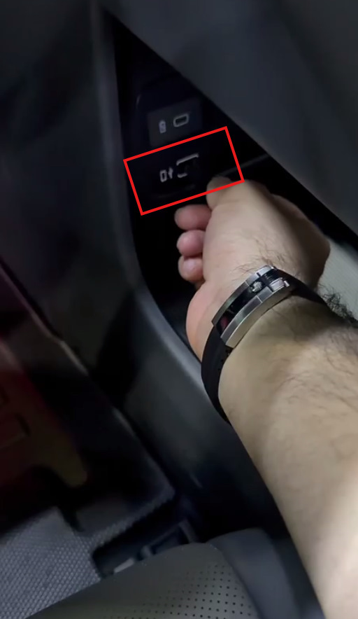

2.2. В появившемся окне выбираем **是的 (Да)**

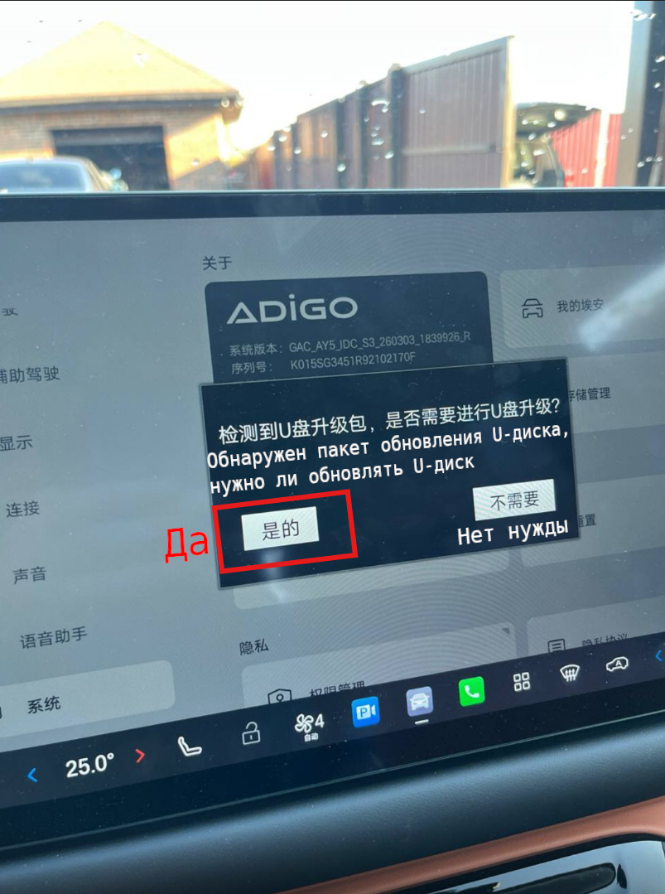

2.3. Выбираем **升级车机软件包 (Обновить программный пакет головного устройства)**

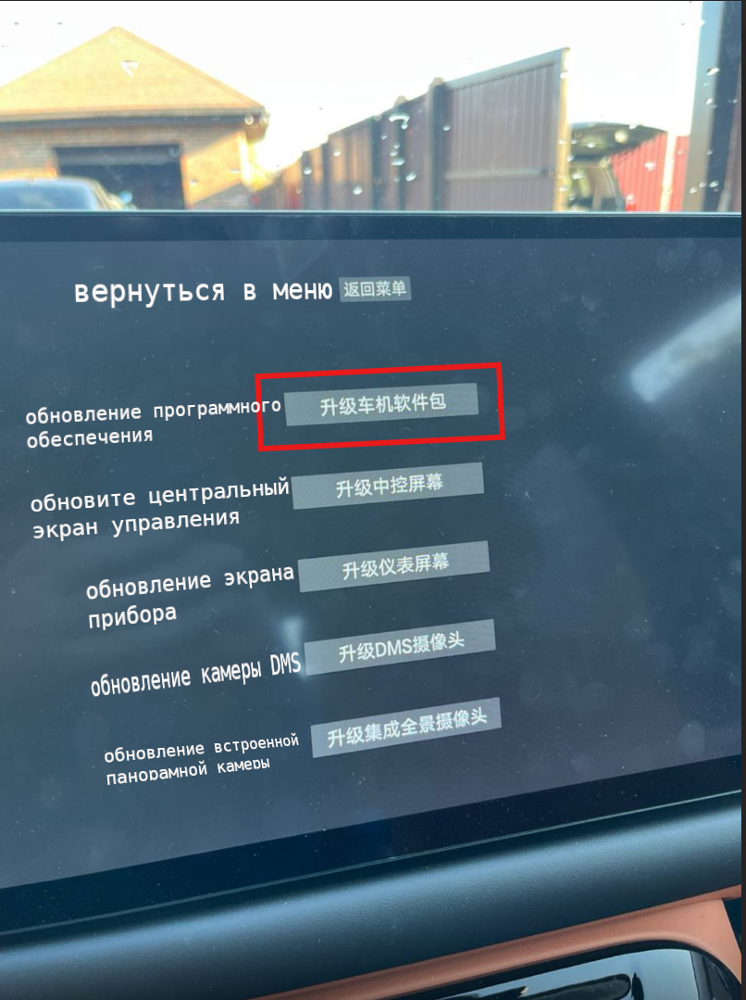

2.4. Далее выбираем файл "**USB_GAC_AY5_IDC_S0_241023_2134EN_1.zip**"

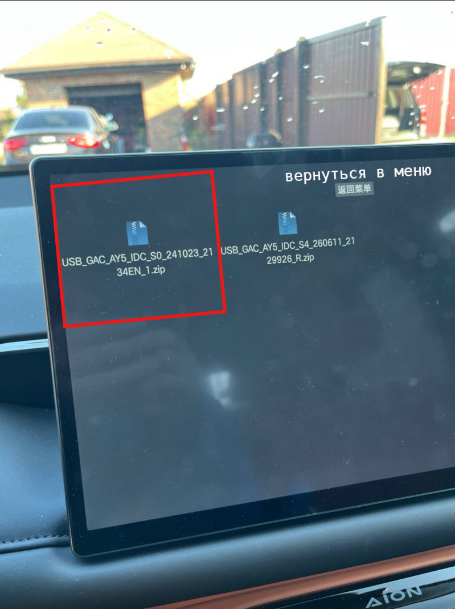

2.5. Далее помечаем галочкой **только пункт avnt**, остальные(dsp, mcu, cluster) оставляем **не выбранными**, после чего нажимаем на **键升级 (Обновить в один клик)**

	1. AVNT(Audio Visual Navigation Terminal) - это самый главный модуль, по сути и есть сама операционная система android, отвечает за интерфейс(меню, экраны), установка приложений, bluetooth, wi-fi.
   
	2. DSP(Digital Signal Processor) - это отдельный чип, который отвечает за звук, ответственен за обработку аудио. Именно в нем находятся эквалайзеры, настройки задержек (Time Correction), срезы частот (кроссоверы) и настройки звуковой сцены.

	3. MCU(Microcontroller Unit) - этот микроконтроллер предназначен для обработки сигналов с CAN-шины автомобиля. Кнопки на руле, отображение температуры климата, датчики парковки, открытие дверей, управление подсветкой салона - всё это проходит через данный модуль.

	4. Сluster - этот модуль отвечает за цифровую приборную панель, которая связана с головным устройством. Прошивка отвечает за отображение навигации, музыки или других данных прямо на панели перед водителем.

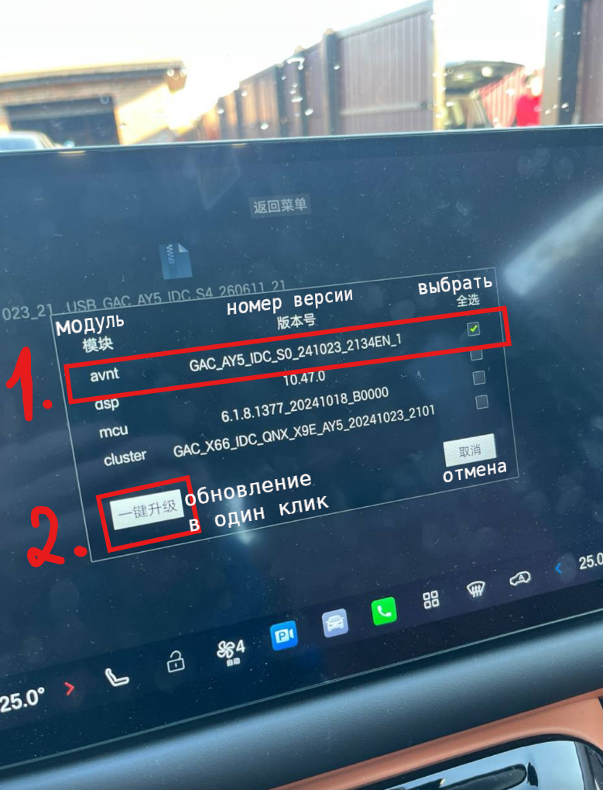

2.6. Начнется загрузка, ждем окончания. После первой загрузки **начнется вторая**, по окончании которой **выключится ГУ и приборная панель**

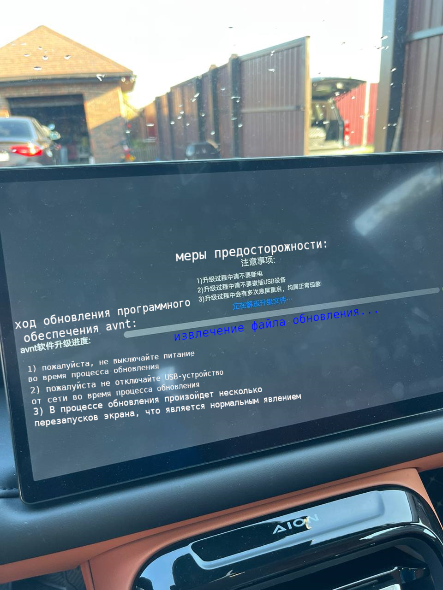

2.7. После обновления по очереди появится **два** окна

2.7.1. На первом жмем **12个月内允许 (Разрешить в течение 12 мес.)**

	Это окно запроса разрешений для приложений или сервисов в операционной системе. Получение "полного опыта использования автомобиля" требует влючение следующих параметров:

	1. 位置信息 (Информация о местоположении) - доступ к геолокации автомобиля. Необходим для навигации, корректной работы карт и некоторых сервисов.

	2. 数据删除 (Удаление данных) — управление данными. Вероятно, это разрешение на очистку кэша или управление памятью устройства.

	3. 摄像头 (Камера наблюдения) — доступ к камерам автомобиля. Это могут быть как камеры кругового обзора, так и фронтальная камера для видеорегистратора или распознавания лиц.

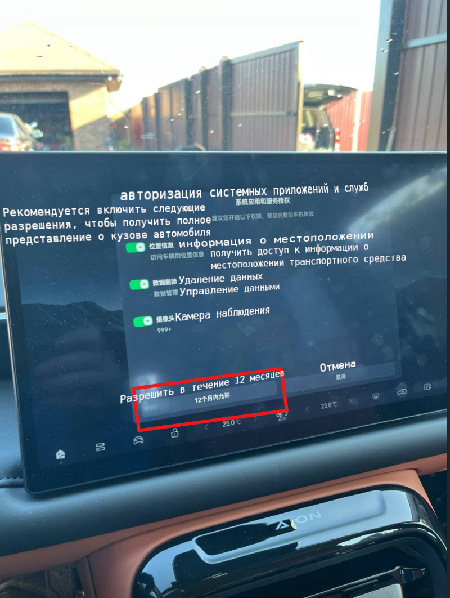

2.7.2. На втором только одна кнопка - **完成 (Завершить)**, жмем на нее

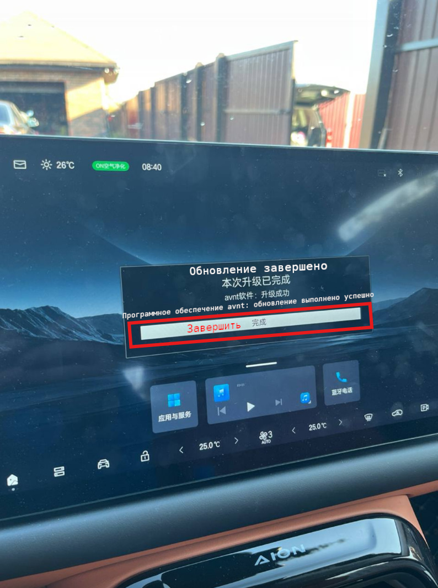

## Шаг 2.5. Подготовительный: Установка ADB на laptop, Раздача hot-stop на laptop

2.5.1. Инструкция по установке **ADB** на laptop:

~~~bash
www.drive2.ru/b/739769016427496940/
~~~

При правильной установке вывод будет примерно таким:

~~~bash
C:\Users\marabella> adb version
Android Debug Bridge version 1.0.41
Version 37.0.0-14910828
...
~~~

Убедитесь, что **ADB** на ноуте **пашет** и **только после этого** переходите к следующему пункту!

2.5.2. Для раздачи **Hot-Spot** на laptop'e **используйте** следующие схемы:

- **В Windows:** Пуск -> Параметры -> Сеть и Интернет -> Мобильный хот-спот. Включите его

- **В Mac:** Системные настройки -> Общий доступ -> Общий интернет (раздать по Wi-Fi)

Убедитесь, что **автомобиль подключен к локальной сети ноутбука**, и **только после этого** переходите к следующему шагу!

## Шаг 3. Запуск ADB на машине, Отключение системных служб

3.1. Повторяем действия, как на фото ниже:

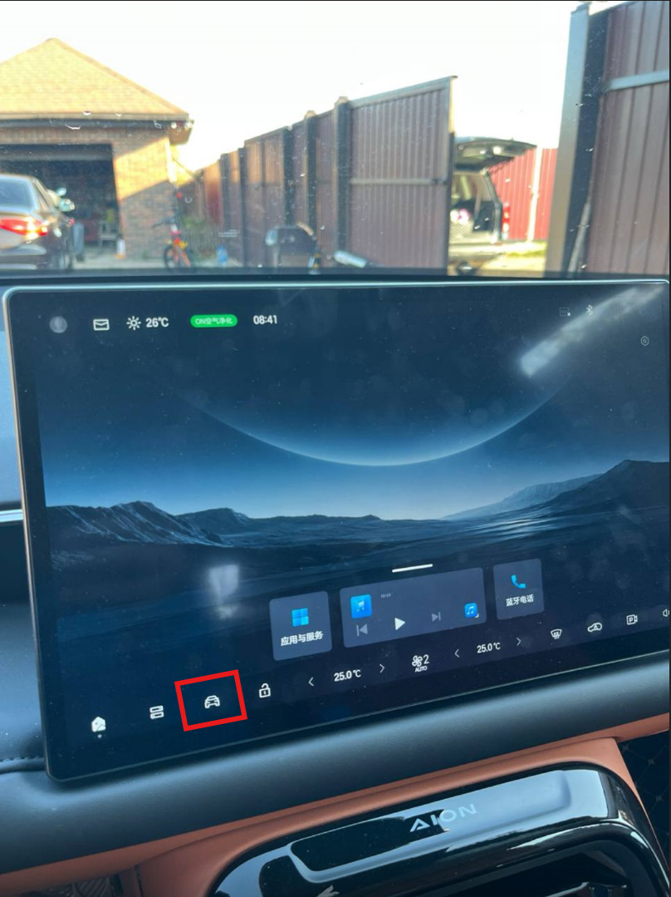

3.2. В открывшемся меню настроек нажимаем на **系统设置** (Системные Настройки)

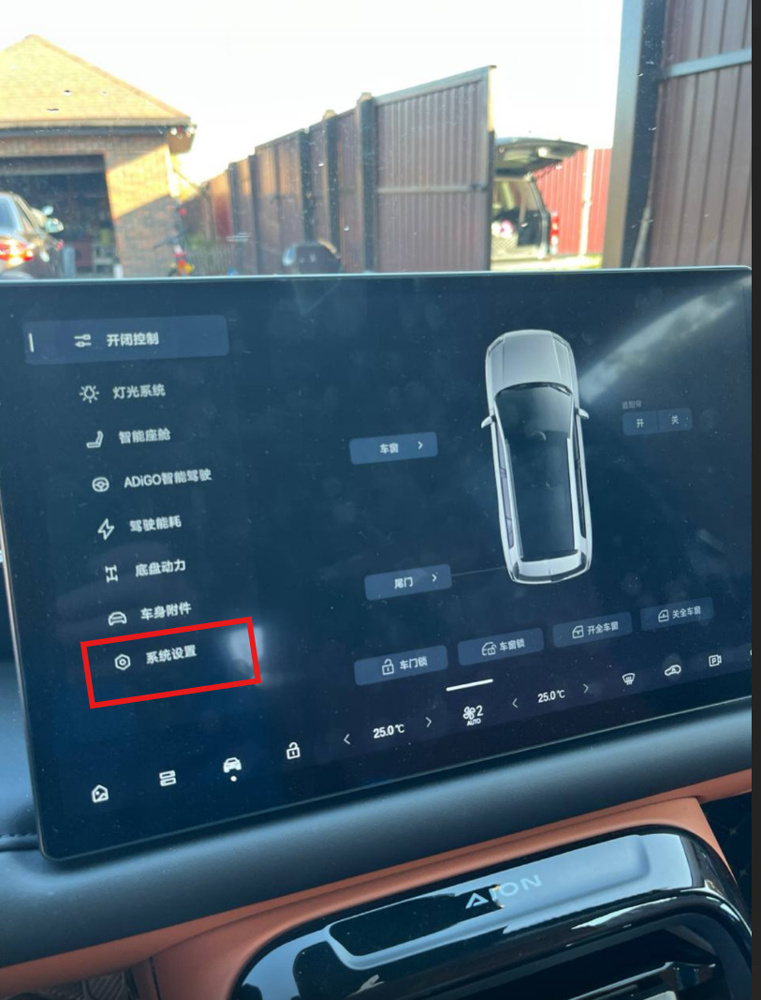

3.3. В настройках находим пункт **时间与日期** (Время и Дата) и **кликаем по нему 8 раз**

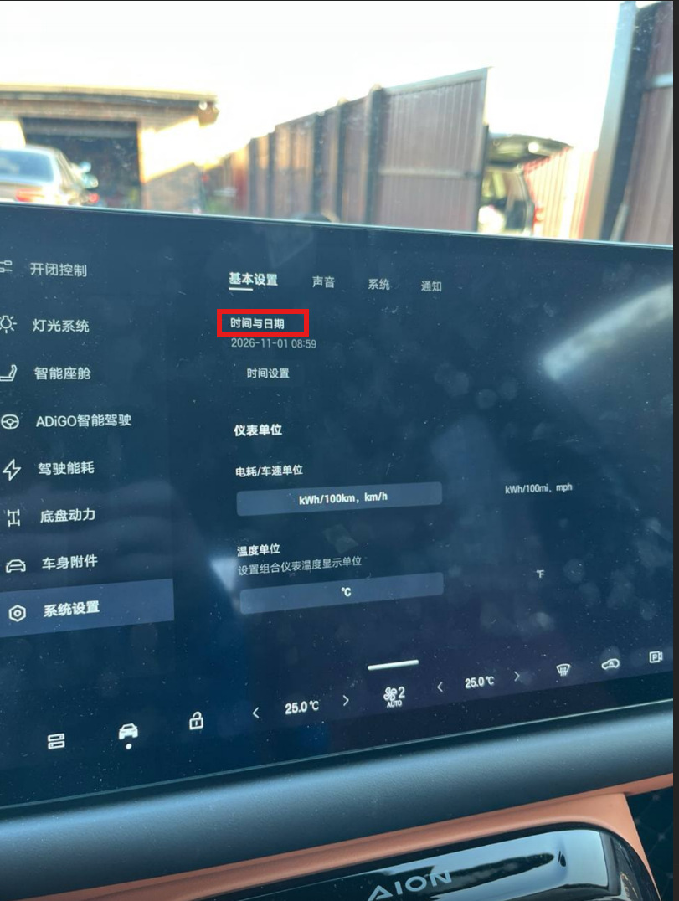

3.4. У нас откроется инженерное меню, **выбираем ADB**

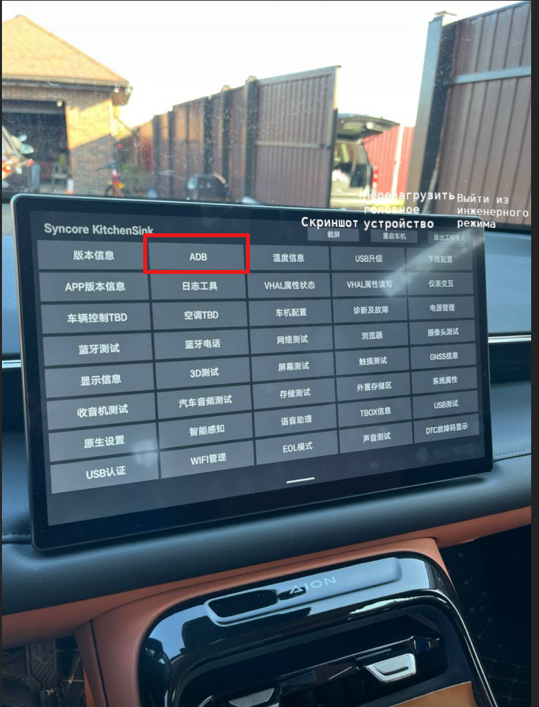

3.5. Далее **включаем 无线调试 (беспроводную отладку)** и **записываем ip-адрес** автомобиля

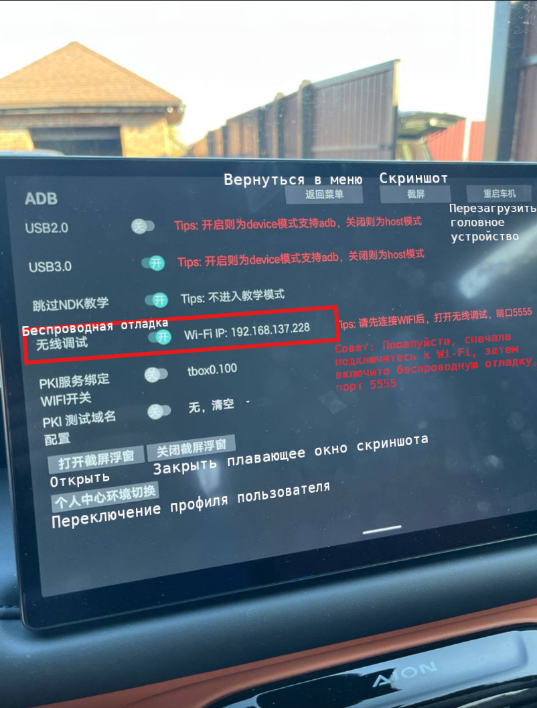

3.6. В терминале **вводим** следующую **команду**, используя ранее записаный **ip-адрес**:

~~~bash
adb connect ip-address
~~~

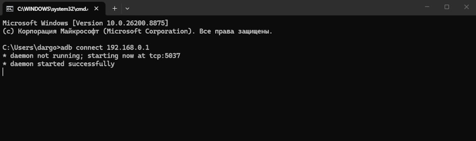

3.7. Вдогонку **выполняем 3 команды**:

~~~bash
adb shell pm disable-user --user 0 com.gxa.firewall
adb shell pm disable-user --user 0 com.gxa.authorize
adb shell pm disable-user --user 0 gxa.car.tbox
~~~

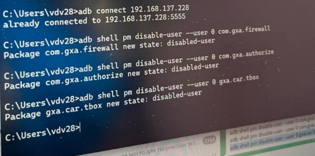

Команды **отключают 3 системных службы**, которые установлены на заводе, чтобы они **не препятствовали** процессу русификации и установке приложений:

1. **com.gxa.firewall (Файрвол / Брандмауэр)**

   - Это системный «страж» безопасности от производителя GXA. Он следит за тем, какие приложения имеют доступ к сети, и **может блокировать** установку **стороннего софта**

   - **Зачем отключать:** Чтобы файрвол **не блокировал установку** новых приложений и **не мешал** системе работать с **ADB**

2. **com.gxa.authorize (Служба авторизации)**

   - Это приложение отвечает за **проверку цифровых подписей** и разрешений. Оно может **требовать подтверждения** при установке сторонних APK-файлов или при попытке **изменить системные настройки**

   - **Зачем отключать:** Чтобы обойти заводскую защиту и позволить устанавливать приложения из неизвестных источников без постоянных блокировок и всплывающих окон

3. **gxa.car.tbox (Телематический блок / T-Box)**

   - Это модуль в машине, который отвечает за **связь с серверами производителя** (телематика, удаленное управление, экстренные вызовы, передача данных о состоянии авто)

   - **Зачем отключать:** В контексте русификации и установки сторонних приложений эта служба часто мешает, так как она **«привязана» к региону**. Отключение этого пакета **предотвращает** передачу телеметрии на китайские серверы и **снимает ограничения**, которые T-Box может накладывать на мультимедиа (например, блокировку сторонних приложений или ограничение доступа к сети)

## Шаг 4. Установка приложений. Русификация пользовательского интерфейса и голосового ассистента

4.1. В **файле решения** находим папку "**apk**", скачиваем ее и открываем

В эту папку **добавляем apk-файлы** которые вы хотите установить. После чего **запускаем батник - "Gac i60 apk installer.bat"**

**Имейте в виду**: установить приложения можно **только ДО обновления**. **После** обновления такой **возможности не будет** - придётся откатываться назад и **проходить процесс заново!!!**

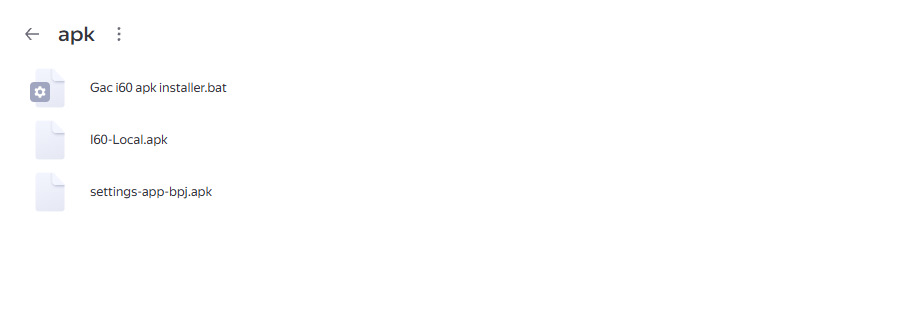

4.2. После установки заходим в папку "**Голос**"

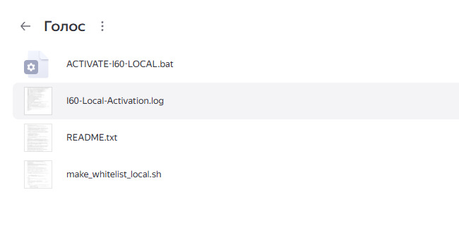

В ней **запускаем** батник "**ACTIVATE-I60-LOCAL.bat**":

~~~bash
[2] Выбор магнитолы
Устройство: 192.168.137.228:5555

[3] Проверка APK и root-ADB
APK установлен, root-ADB доступен.

[4] Микрофон, оверлей и работа в фоне

[5] Проверка разрешений
Микрофон: разрешен.
Оверлей: разрешен.
Батарея: приложение в белом списке.

[6] Защита от выгрузки из памяти
Менеджер: PID 2276 -> 19676

[7] Запуск I60 Local Test

===========================================================
Запуск приложения запрошен. Проверь экран ГУ.
Защита: XML подключен, процесс менеджера перезапущен
Предупреждений: 0
Журнал C:\Users\vdv28\OneDrive\Рабочий стол\Aion\I60 Voice\I60-Local-Activation\I60-Local-

Специальные возможности включи для I60 Local Test вручную.
Если приложение требует свое ADB-подключение, настрой его в приложении.
Оригинал и тестовую копию не запускай одновременно.
После перезагрузки ГУ временный bind-mount нужно применить заново.
===========================================================
Press any key to continue . . .
~~~

1. **XML подключен**

	В системе Android есть файлы конфигурации в формате **XML** (например, deviceidle.xml, package-whitelist.xml или файлы политики энергосбережения power_profile.xml). В этих файлах прописано, каким приложениям **разрешено работать в фоне**, а каким - нет

	Когда скрипт пишет «**XML подключен**», это значит, что батник через ADB **подменил или изменил этот системный XML-файл**. Он **вписал туда ваше** приложение I60 Local Test, чтобы система считала его **«своим»** и **не убивала**

2. **Процесс менеджера перезапущен**

	Какой именно менеджер? В Android есть несколько системных служб, но **в контексте ограничений фоновой работы и разрешений** речь обычно идет о **Package Manager** (Менеджер пакетов) или **Activity Manager** (Менеджер активности):

	- **Package Manager** - отвечает за **установку**, **удаление** приложений и **хранение** их разрешений. Если вы на лету изменили системный файл с настройками, **Package Manager** **не увидит изменений**, пока не **перечитает** этот файл. Поэтому **скрипт перезапускает его процесс**

	- **Activity Manager** - управляет тем, какие приложения сейчас работают, и **распределяет память**. Если вы добавили приложение в «**белый список**», этот менеджер **должен «узнать» об этом**, чтобы **перестать его принудительно закрывать**

3. **Специальные возможности включи для I60 Local Test вручную**

	Зайдите в меню "**All Settings**" (которое установилось **settings-app-bpj.apk** файлом), найдите раздел "**Специальные возможности/Accessibility**" и **включите I60 Local Test**. Без этой галочки ассистент **не сможет «видеть»**, что происходит на экране, и **не сможет нажимать за вас кнопки**

4. **Если приложение требует свое ADB-подключение, настрой его в приложении**

	Некоторые такие ассистенты работают через свой **собственный «мост»** (например, через отдельный Wi-Fi). Это значит, что внутри самого приложения может быть **меню**, где **нужно еще раз ввести IP-адрес**

5. **Оригинал и тестовую копию не запускай одновременно**

	Вы установили **две версии** ассистента. Одна — **«оригинал»** (стабильная, может быть урезанная), вторая — **«тестовая»** (возможно, с новыми функциями, но с багами). Если вы запустите обе сразу, они **начнут драться за микрофон**.

6. **После перезагрузки ГУ временный bind-mount нужно применить заново**

	Это ключевой момент. **Bind-mount** - это технический прием в **Linux/Android**, когда **файл или папка «подменяются» на лету**.
	Скорее всего, батник **подменяет какой-то системный файл**, чтобы **«пропихнуть» голосового ассистента в систему** (например, чтобы он **перехватывал нажатие кнопки** на руле или работал в качестве системного). Но эта подмена работает **ТОЛЬКО ДО перезагрузки**. Как только вы **заглушите** машину и заведете ее снова, **магнитола перезагрузится, и «чары» спадут**. Ассистент перестанет работать. Именно поэтому батник **придется запускать заново ПОСЛЕ КАЖДОЙ перезагрузки ГУ** (если вы хотите им пользоваться)

4.3. Для русского языка, открываем приложение "**Settings"**

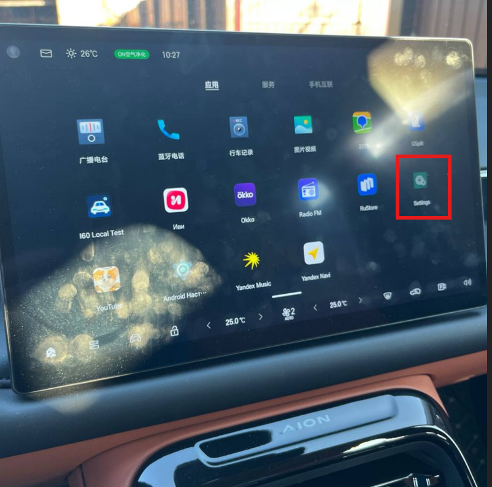

В открывшемся приложении нажимаем **"All Settings"**

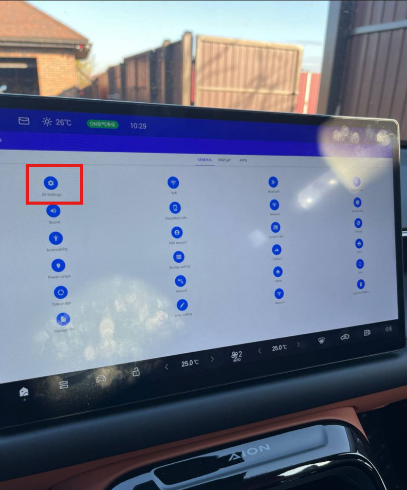

4.4. Листаем в самый низ и выбираем **系统 (Система)**

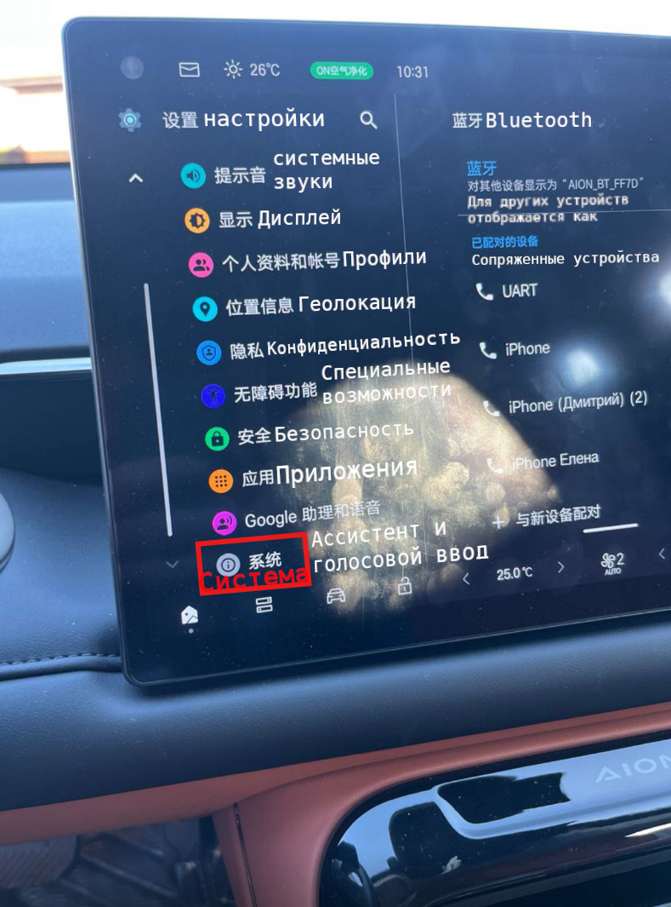

4.5. Нажимаем **语言和输入法 (Язык и ввод)**

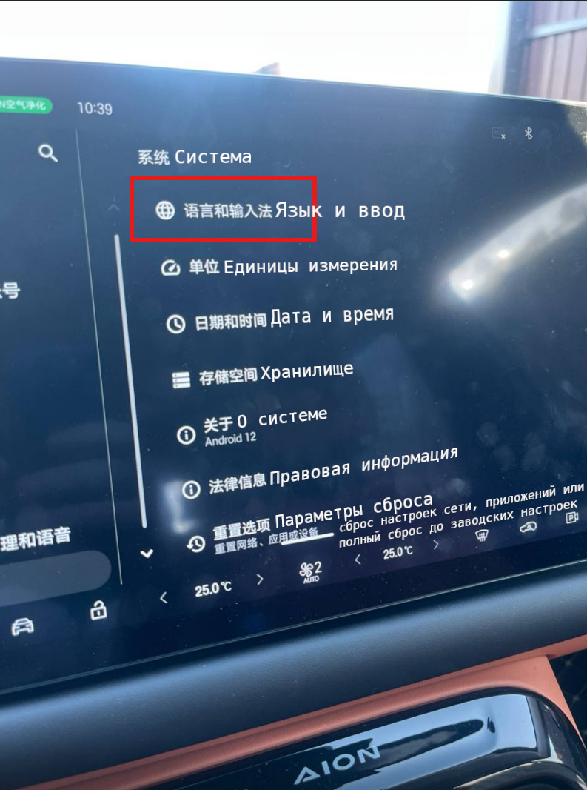

4.6. Выбираем **语言 (Язык)** и **ищем в нем русский язык**

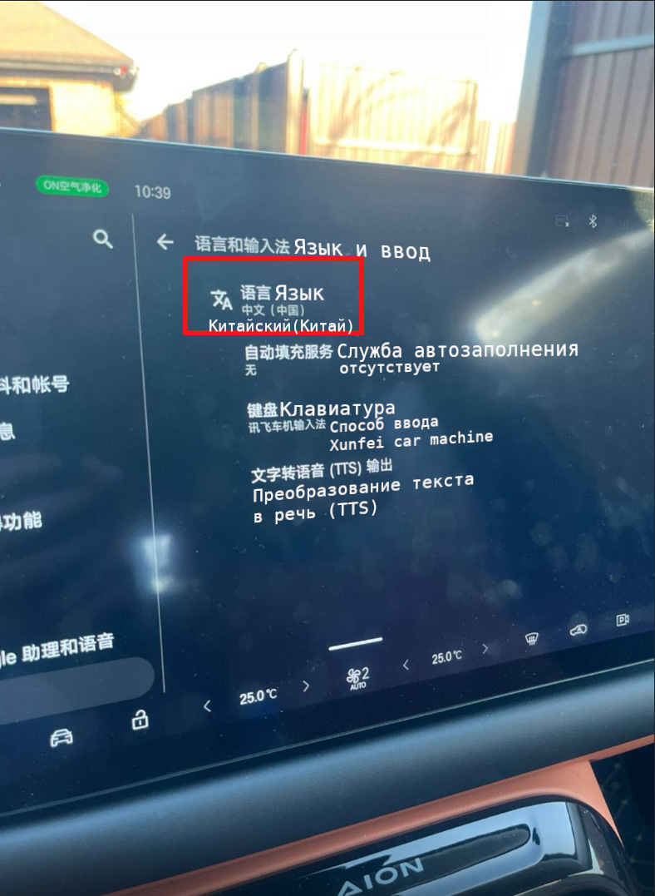

## Шаг 5. Обновление ГУ на актуальную версию

5.1. Вставьте флешку заново и [повторите алгоритм второго шага](#шаг-2-обновление-авто) - **до** момента, когда откроется **окно выбора файлов**, в нем выбираем **USB_GAC_AY5_IDC_S4_260611_2129926_R.zip**:

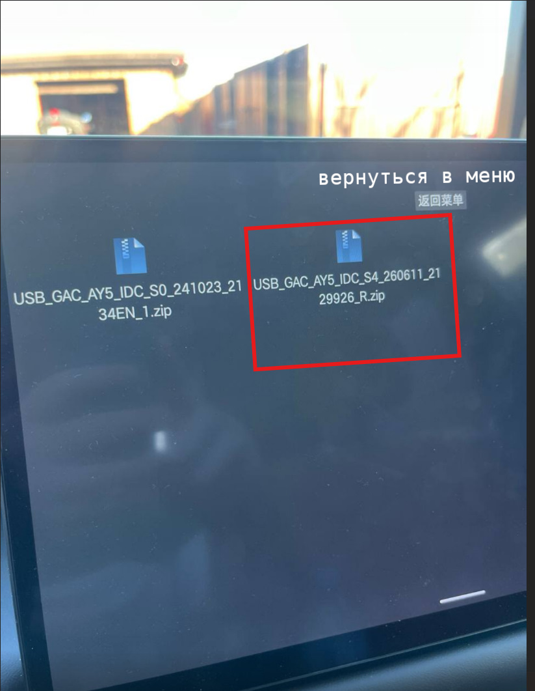

5.2. На этот раз **оставляем модули** для обновления **в исходном состоянии** и сразу переходим к установке - **键升级 (Обновить в один клик)**

	!Внимание, если версия ГУ другая, мдули требующие обновления могут разниться, уточняйте в лс!

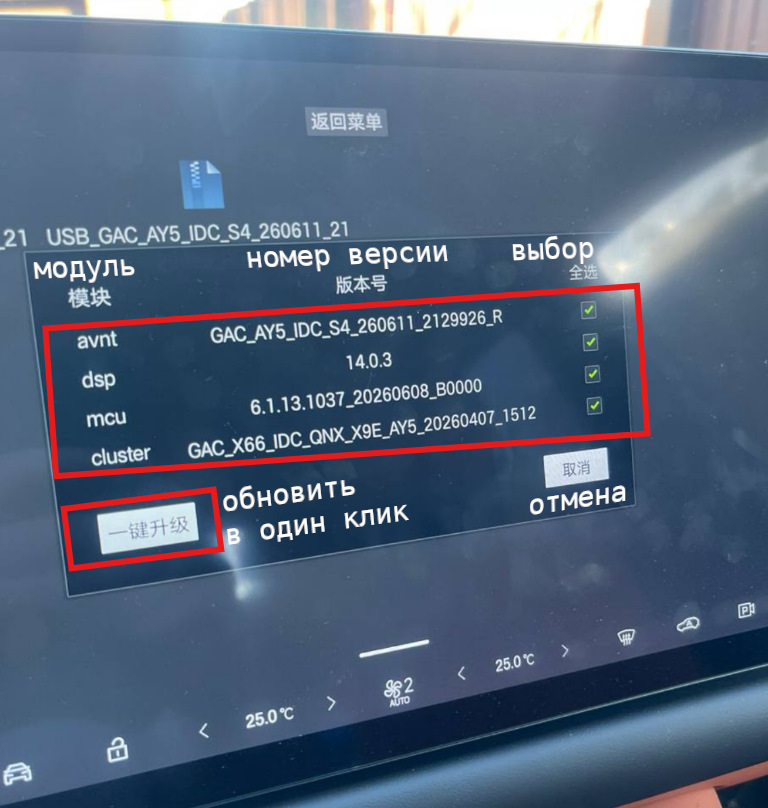

**Финал, теперь наше авто на русском!**

[Если я в чём-то сомневаюсь, я возвращаюсь к началу](#гайд-на-русификацию-gac-aion-v)
